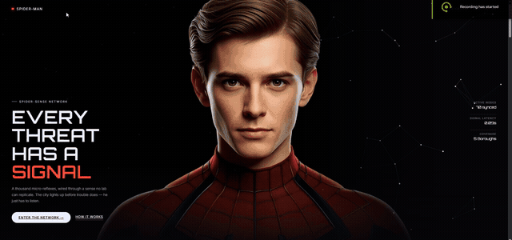

# Spider-Man // Neural Web

A cinematic, single-file fan-concept hero landing page for Spider-Man — built as a scroll-driven story rather than a static page.



**Live demo:** https://jolly-cherry-2a8f.dnanima895.workers.dev

## What it does

The hero opens on Peter Parker's unmasked face with a cursor-reactive spider-sense particle network behind him. As you scroll:

1. A pinned scroll-scrub section smoothly morphs the face into the full mask — not a simple crossfade, but a lerp-smoothed transition with a soft blur/scale "lens settling" effect timed to scroll position.
2. A hanging Spider-Man sticker swings in from a web thread at the top of the frame, with a gentle idle sway.
3. A leaping action shot slides in from the right edge.
4. A closing section renders an 89-frame image sequence on `<canvas>` (not a seeked `<video>`, which stutters badly when scrubbed) so the final animation plays back frame-accurately in sync with scroll — complete with inverted colors so the plate's white background reads as pure black, blending seamlessly into the page.

Everything — every image, every animation frame — is embedded as base64 inside the one HTML file. Drop it on any static host and it just works.

## Features

- Scroll-scrubbed mask transition with lerp smoothing (no jank, no linear snapping)
- Real-time canvas particle network reacting to cursor position
- Frame-sequence scroll scrubbing for buttery-smooth animation (video `currentTime` seeking was tried first and rejected — it stutters on compressed video)
- Fully responsive: desktop, tablet, and mobile all get intentional, recomposed layouts
- `prefers-reduced-motion` support throughout
- Zero dependencies, zero build step — one HTML file

## Tech stack

Vanilla HTML, CSS, and JavaScript. No frameworks, no bundler. Fonts loaded from Google Fonts; everything else is inline.

## Running locally

Just open `index.html` in a browser, or serve it with any static file server:

```bash
npx serve .
```
